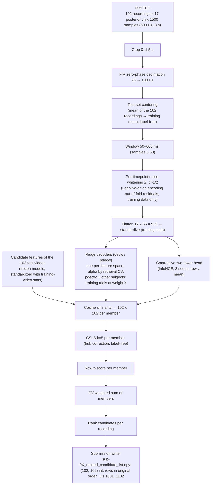

# Architecture of the final pipeline

**Task.** EEG was recorded (17 posterior channels, 500 Hz, 3 s) while people watched 3 s video clips with sound. For each
test recording, rank the 102 test videos (IDs 1001–1102, never seen in training) from most to least likely. The design is
**zero-shot retrieval**: we learn a map from EEG into frozen video/audio feature spaces, then match.

**Final submission:** `submissions/final_v4b_csls/` (v4b): dev (sub-01..04) **33.8% top-1 / 68.1% top-5 /
median rank 2.6** (chance 1.0 / 4.9 / 51.5), leave-one-fold-out train-CV 0.28716. Projection for the scored sub-05/06 (the
two weakest subjects by CV): sub-05 ~26% / ~60%, sub-06 ~18% / ~49% (probably optimistic).

## 1. Data flow

Every fitted quantity (whiteners, scalers, ridge maps, alphas, contrastive weights, early stopping, ensemble weights) comes
from the subject's **training** recordings only. Test EEG and test-video features enter only at scoring; centering and
CSLS use only the unlabeled test set (CSLS approved by the organizers). Dev labels are read only after the files are
written.

**Why each step is there** (dev top-1, cumulative): the organizers' AlexNet encoding recipe, re-implemented, 2.0% (M0) →
fixing a scaler bug that made ridge alpha a no-op, 5.4% (M2) → **decoding** EEG → features instead of predicting EEG,
14.0% (M3) → **noise-whitened** input, 14.7% / 42.2% (M8a) → CV-weighted **ensemble** of feature spaces, 20.8% (M17) →
centering + **CSLS**, 24.0% / 57.1% (final_csls) → **low-level vision and audio** members, 32.4% / 66.7% (v3, M25) →
**subject pooling** of three decoders, 33.8% / 68.1% (v4b, M28). The useful signal sits in 50–600 ms; wider windows hurt.

## 2. Member families

| Family | Member (cache name) | Model / version | What it contributes | Weight in v4b |
|---|---|---|---|---|
| Semantic image | `pdecw:dinov2_b_patch_all` | DINOv2 ViT-B/14, timm `vit_base_patch14_dinov2.lvd142m` rev `4685c99d…`, mean of patch tokens, 8 frames; subject-pooled (λ = 0.1) | strongest single member by CV (M10); object/scene structure | **0.2** |
| Temporal video | `decw:vjepa2_l_all:16` | V-JEPA 2 ViT-L `facebook/vjepa2-vitl-fpc64-256` rev `b3c1679b…`, 16 frames | video dynamics (M16/M17) | **0.1** |
| Trained objective | `con:clip_b32:two_tower_d256` | InfoNCE two-tower head on open_clip ViT-B-32 `laion2b_s34b_b79k` (rev `1a25a446…`) targets, 3 SGD seeds | weak alone, complementary errors (M12/M13); dropping it costs 0.005 LOFO (M27) | **0.1** |
| Low-level spatial | `pdecw:alexnet_c5p6:8` | torchvision AlexNet `IMAGENET1K_V1`, conv5 pooled 6×6, 8 frames; subject-pooled (λ 0.05–0.1) | posterior electrodes track edges / contrast / layout (M24) | **0.2** |
| Hand-crafted | `decw:lowlevel_all:1` | colour, spatial-frequency, edge and motion descriptors (`eegmr.lowlevel`, no model) | interpretable low-level statistics (M24) | **0.1** |
| Audio | `decw:clap_all:1` | LAION-CLAP `laion/clap-htsat-unfused` rev `8fa0f1c6…` | the clips have sound; low overlap with vision (RSA 0.18 vs CLIP) (M20) | **0.1** |
| Low-level AV over time | `pdecw:lowav_all:1` | per-100 ms luminance / contrast / edges / motion + RMS / onset / 8 mel bands (`eegmr.audio`, no model); subject-pooled (λ 0.05–0.1) | time-resolved low-level drive (M20/M21) | **0.2** |

Dropped along the way (weight 0 or below the +0.002 LOFO rule): the CLIP B-32 decoder, CLIP block-8 CLS, AlexNet conv2,
EEGNet (s3), pooling of the other three decoders (v4c, +0.0003).

**Tried and not used:** encoding models as members (M5/M9), reliability-weighted cosine (M8b:
CV preferred it, dev did not confirm), more frames / onset pooling (M6), CLIP L-14 (M18), nonlinear EEG encoders standalone
(M14: EEGNet is data-limited; a small gain as a member), zero-shot transfer from THINGS-EEG2 (M15), motion gating (M23).

## 3. Selection protocol

1. **Training-only CV** per subject: 5 folds over the training videos (`KFold(5, shuffle=True, random_state=0)`).
   Whiteners and matchers are re-estimated inside each fold. Score = mean percentile rank of the true video and expected
   top-1 / top-5 among 102 candidates (hypergeometric).
2. **Alphas** by retrieval CV on each subject's training set (the decoder's alpha nested for the whitened input).
3. **Ensemble weights** on the simplex (steps of 0.1): exhaustive for ≤ 7 members (8,008 points), steepest-ascent
   pair transfers beyond that, maximizing (E[top-1] + E[top-5]) / 2.
3b. **Subject pooling λ** (pooled members): per subject, (λ, alpha) on {0, 0.05, 0.1, 0.2, 0.5} × the alpha grid by
   zero-shot CV, in which the other subjects' recordings of the held-out videos are removed.
4. **Strategy by leave-one-fold-out** (weights picked on 4 folds, scored on the 5th): best single / equal / global /
   per-subject; **the simplest strategy within 0.0005 of the best wins** (complexity tie-break). A member is kept only if it
   adds more than ~0.002 LOFO like for like.
5. **Dev (sub-01..04 test sets) only to confirm**, with a paired Wilcoxon on 408 per-trial ranks. Caveat:
   the *candidate set* (window, centering, CSLS, member pool) was screened on dev several times, so dev is an optimistic
   estimate for sub-05/06.

## 4. Training vs inference

- **Training** (`training/`, GPU): `bash training/run_pipeline.sh` extracts the frozen features once
  (`extract_features.py`, `lowlevel_features.py`, `extract_audio.py`), fits the unpooled decoders of the pooled feature
  sets (for their alphas), builds the subject-pooled members (`pool_member.py`), fits the remaining members and chooses
  the weights by CV (`ensemble.py`), writes the ranked lists, and exports the fitted parameters to `inference/model/`.
  `JOBS=3` runs the subjects in parallel (same outputs).
- **Inference** (`inference/`, CPU, numpy + scipy only): `inference/model/` holds per subject and member the whiteners,
  standardization stats, the ridge map B = V·diag(S/(S²+α))·Uᵀ(Y − ȳ) (pooled: the weighted ridge at the chosen λ) or the
  contrastive projections, the training EEG mean, plus the 102 candidate vectors, with SHA-256 hashes in `meta.json`.
  `inference/predict.py` reproduces `submissions/final_v4b_csls` **bit-identically** and dev 33.8 / 68.1 in about 2 s.

## 5. Code map

| Where | What |
|---|---|
| `training/src/eegmr/data.py`, `evaluate.py`, `submission.py` | loading, crop + decimation; top-k / median rank; the validated submission writer |
| `training/src/eegmr/features.py`, `lowlevel.py`, `audio.py` | frozen extractors (CLIP, DINOv2, V-JEPA, AlexNet, descriptors, low-level AV, CLAP) and caches |
| `training/src/eegmr/linear.py`, `decoding.py`, `contrastive.py`, `matching.py` | ridge, whitened decoder, InfoNCE heads, Ledoit-Wolf noise whitening |
| `training/src/eegmr/gpu.py`, `retrieval.py` | torch ridge / retrieval-CV helpers (parity-tested vs sklearn); CSLS |
| `training/scripts/ensemble.py`, `pool_member.py` | CV-weighted ensemble (final pipeline); subject-pooled decoders |
| `training/scripts/export_bundle.py`, `inference/predict.py` | export of the fitted parameters; the standalone predictor |
| `research/scripts/` | experiments not in the final model (single-model `predict.py`, Stage 3 EEGNet, THINGS-EEG2, sweeps) and the audit tooling |

## 6. Reproducibility

- **Environment:** Python 3.11.17; every third-party import pinned in `training/requirements.txt` and equal to the installed
  versions (numpy 2.4.6, scipy 1.17.1, scikit-learn 1.9.1, torch 2.11.0+cu128, open_clip 3.3.0, timm 1.0.30,
  transformers 5.18.0, av 18.1.0 for audio).
- **Models:** every public model is loaded at a pinned revision: CLIP B-32 `1a25a446…`, DINOv2 `4685c99d…`, V-JEPA 2
  `b3c1679b…`, CLAP `8fa0f1c6…`; AlexNet uses the versioned torchvision file. V-JEPA 2 runs in fp16, and the all-frame
  caches store fp16 embeddings.
- **Determinism and controls:** from-scratch reruns are bit-identical (test and CV side, including the
  contrastive seeds); permuting the test recordings permutes the output rows exactly; training on shuffled EEG–video
  pairs gives chance (1.0 / 4.7); the committed sub-05/06 files equal a fresh rerun.
- **Data rules:** no organizer code; external models are public and released before 2026-10-16.
